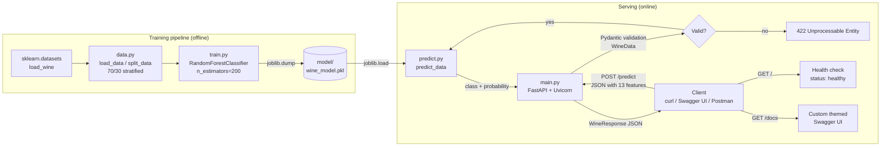
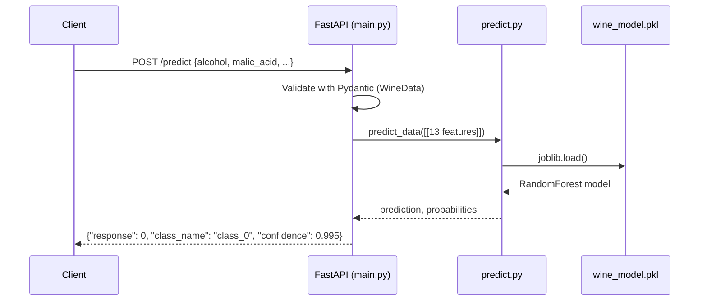
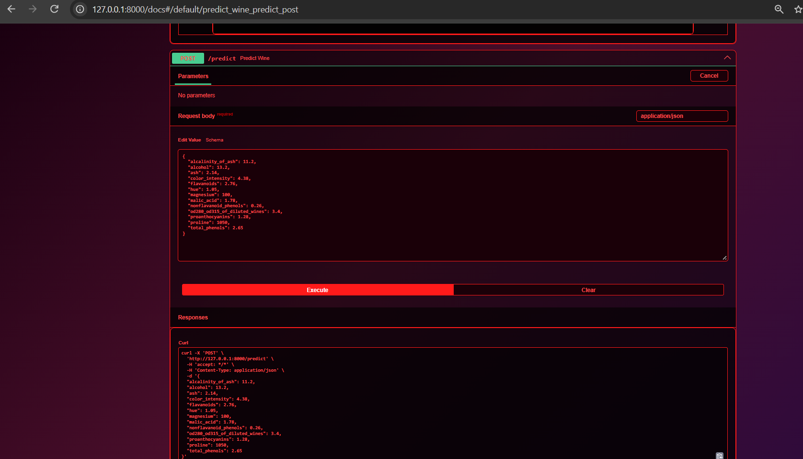

# 🍷 FastAPI Lab — Wine Classifier

This is a version of the [MLOps FastAPI Lab](https://github.com/raminmohammadi/MLOps/tree/main/Labs/API_Labs/FastAPI_Labs) that serves a **RandomForest** model trained on the **sklearn Wine dataset** through a **FastAPI** REST API. The API docs page (Swagger UI) has a custom dark wine theme.

| | Original lab | This lab |
|---|---|---|
| Dataset | Iris (4 features, 3 classes) | **Wine** (178 samples, 13 chemical features, 3 cultivar classes) |
| Model | DecisionTreeClassifier | **RandomForestClassifier** (200 trees) |
| Response | class id | class id + class name + **confidence** |
| Docs UI | default Swagger | **custom themed Swagger** (red text and red bordered boxes on a dark gradient) |

**Test accuracy:** 100% (stratified 70/30 split, `random_state=12`)

---

## Architecture



### Request flow



---

## Project structure

```
LAB03_FASTAPI/
├── model/
│   └── wine_model.pkl        # trained model (created by train.py)
├── src/
│   ├── data.py               # load + split the Wine dataset
│   ├── train.py              # train RandomForest, save model
│   ├── predict.py            # load model, predict class + probability
│   └── main.py               # FastAPI app + custom Swagger theme
├── Screenshot_fast_API.png   # Swagger UI screenshot
├── requirements.txt
└── README.md
```

---

## How to run

### 1. Clone and set up
```bash
git clone https://github.com/Aakash-2904/LAB03_FASTAPI.git
cd LAB03_FASTAPI
python -m venv venv
venv\Scripts\activate            # Windows
# source venv/bin/activate       # macOS / Linux
pip install -r requirements.txt
```

### 2. Train (optional, since a trained model is already included)
```bash
cd src
python train.py
# Test accuracy: 1.0000
```

### 3. Start the API
```bash
uvicorn main:app --reload        # run from inside src/
```

### 4. Use it
Open **http://127.0.0.1:8000/docs**, expand **POST /predict**, then click **Try it out** and **Execute**. A sample wine is already filled in.

---

## Endpoints

| Method | Path | Description |
|---|---|---|
| GET | `/` | Health check → `{"status": "healthy"}` |
| POST | `/predict` | Predict the wine class from 13 features |
| GET | `/docs` | Custom themed Swagger UI |

### Example request
```bash
curl -X POST http://127.0.0.1:8000/predict \
  -H "Content-Type: application/json" \
  -d '{"alcohol":13.2,"malic_acid":1.78,"ash":2.14,"alcalinity_of_ash":11.2,"magnesium":100,"total_phenols":2.65,"flavanoids":2.76,"nonflavanoid_phenols":0.26,"proanthocyanins":1.28,"color_intensity":4.38,"hue":1.05,"od280_od315_of_diluted_wines":3.4,"proline":1050}'
```

### Example response
```json
{"response": 0, "class_name": "class_0", "confidence": 0.995}
```

### Test results
| Input | Output |
|---|---|
| `GET /` | `{"status":"healthy"}` |
| class 0 sample | class_0, confidence 0.995 |
| class 1 sample | class_1, confidence 0.90 |
| class 2 sample | class_2, confidence 0.985 |
| invalid input (`"alcohol": "x"`) | HTTP 422 |

---

## Screenshot


